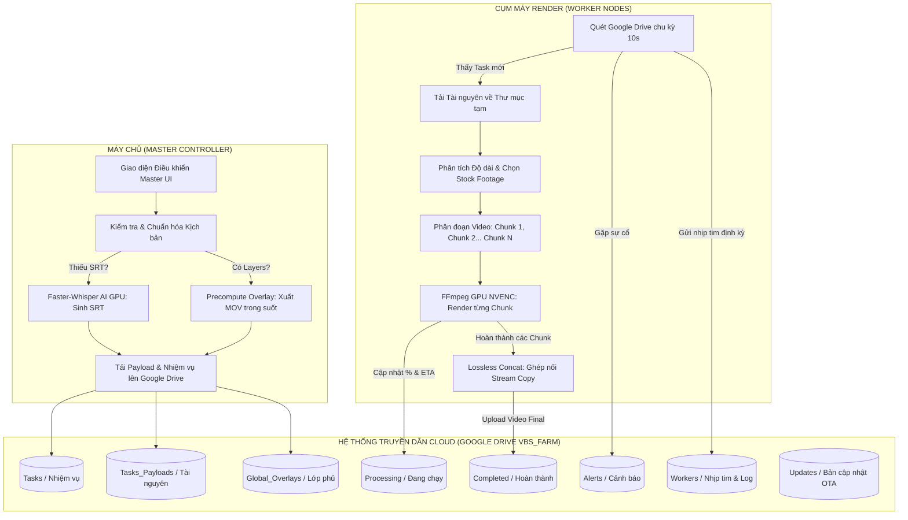

# HỆ THỐNG PHẦN MỀM VIDEO BATCH STUDIO (VBS)
## TÀI LIỆU TỔNG QUAN NĂNG LỰC & NGUYÊN LÝ HOẠT ĐỘNG TOÀN DIỆN (PROGRAM.MD)
*Phiên bản hiện tại: **v2.5.9** | Kiến trúc: **Master-Worker Remote Render Farm (Serverless qua Google Drive API)***

---

## 1. TỔNG QUAN HỆ THỐNG

**Video Batch Studio (Desktop Offline & Remote Render Farm)** là giải pháp phần mềm chuyên nghiệp phục vụ sản xuất video hàng loạt tự động với quy mô công nghiệp. Phần mềm giải quyết trọn vẹn bài toán từ khâu chuẩn bị tài nguyên (âm thanh, kịch bản, phụ đề, hình ảnh) cho đến khâu dựng hình (composition), tách phông xanh (greenscreen/chromakey), chèn lớp phủ (overlay/logo/khung viền), và kết xuất video siêu tốc trên nhiều máy tính độc lập (Render Farm).

### Điểm đột phá kiến trúc:
Khác với các hệ thống Render Farm truyền thống đòi hỏi cấu hình mạng nội bộ phức tạp, mở cổng mạng (Port Forwarding), thuê IP tĩnh hoặc máy chủ trung gian đắt đỏ, **VBS hoạt động theo mô hình Serverless qua Google Drive API**:
- **Máy chủ (Master Controller):** Soạn thảo kịch bản, chọn mẫu dựng (Template), điều phối nhiệm vụ và giám sát toàn bộ các máy render từ xa.
- **Cụm máy kết xuất (Worker Nodes):** Các máy tính độc lập (máy công ty, máy tại nhà, laptop, VPS) kết nối vào hệ thống chỉ bằng một đường link thư mục Google Drive dùng chung.
- **Hệ thống truyền dẫn 0 cổng (Zero-Port Backbone):** Toàn bộ việc nhận lệnh, truyền tải tài nguyên, báo cáo tiến độ từng giây, phát hiện lỗi và cập nhật phần mềm đều diễn ra tự động 100% qua Google Drive.

---

## 2. NHỮNG GÌ ỨNG DỤNG ĐANG LÀM ĐƯỢC (TÍNH NĂNG & NĂNG LỰC CỐT LÕI)

### 2.1. Dựng Video Tự Động Hàng Loạt Chuẩn 16:9 & 9:16
- **Tự động hóa 100% quy trình dựng:** Ghép nối âm thanh lồng tiếng (Voice), phân tích nhịp giọng, tạo video nền chuyển động ngẫu nhiên từ kho Stock Footage có sẵn, chèn phụ đề Karaoke chạy chữ và lồng ghép các lớp phủ đồ họa (Khung viền, Logo, Watermark, Hiệu ứng nhiễu Analog, Ánh sáng).
- **Hỗ trợ đa dạng nội dung:** Tối ưu hóa chuyên sâu cho các kênh YouTube Drama Mỹ (Billionaire Stories, Mafia Boss & Maid), Kênh Tâm sự Nhật Bản (Kaishacho Reversal), Kênh Tin tức, Kênh Review phim và Video ngắn Shorts/Reels/TikTok.

### 2.2. Kết Xuất Siêu Tốc Bằng GPU Đạt 5.5x – 6.0x (130 – 150 FPS)
- **Tận dụng tối đa phần cứng đồ họa rời:** Hỗ trợ toàn diện công nghệ mã hóa phần cứng **NVIDIA NVENC** (h264_nvenc, hevc_nvenc trên RTX 3060, 4060, 5060 Ti, GTX 1060...), **Intel QuickSync (QSV)** và **AMD AMF**.
- **Tối ưu tốc độ vượt bậc:** Video dài 27 phút chỉ mất khoảng **4 đến 5 phút** để hoàn tất toàn bộ quá trình render (nhanh gấp 6 lần thời gian thực).

### 2.3. Công Nghệ Đột Phá: Precomputed Loop Overlay Cache
- **Giải quyết triệt để nút thắt cổ chai CPU:** Với các template chứa nhiều video phông xanh (4–5 video hiệu ứng chạy đè nhau như nút Đăng ký, Nhạc sóng, Tạp âm analog, Khung viền), FFmpeg truyền thống sẽ bị nghẽn 100% CPU do phải giải mã và chạy bộ lọc `chromakey` liên tục từng frame, khiến GPU bị bỏ đói (GPU chạy 0%).
- **Cơ chế Precompute độc quyền:** Máy chủ Master tự động gộp và kết xuất trước toàn bộ các lớp đồ họa phức tạp thành **1 file video trong suốt (Alpha Channel QuickTime ProRes / PNG MOV)** duy nhất. Máy Worker khi render chỉ cần nạp đúng 1 layer video trong suốt này đè lên video nền, giảm tải CPU từ 85% xuống 10%, giải phóng hoàn toàn công suất GPU NVENC đạt 80-95%.

### 2.4. Render Phân Đoạn Song Song (Chunk Render Engine) & Ghép Nối Lossless
- **Chia để trị (Chunking):** Tự động chia video dài (ví dụ: video 30 phút chia thành 5 phân đoạn nhỏ 6 phút). Mỗi phân đoạn được tính toán khớp chính xác từng mili-giây với file âm thanh và phụ đề tương ứng.
- **Ghép nối Lossless Concat siêu tốc:** Sau khi các phân đoạn render xong, hệ thống ghép nối chúng lại thành 1 video duy nhất bằng kỹ thuật ghép luồng trực tiếp (Stream Copy). Quá trình ghép chỉ mất **3 đến 5 giây**, không phải re-encode lại, bảo toàn 100% độ sắc nét hình ảnh và chất lượng âm thanh.
- **Cơ chế phục hồi sự cố (Resume on Failure):** Nếu máy render bị mất điện hoặc tắt đột ngột, khi bật lại máy sẽ tự động kiểm tra những phân đoạn đã xong và chỉ render tiếp những phân đoạn còn dở dang, không bao giờ phải render lại từ đầu.

### 2.5. Tự Động Tạo Phụ Đề Bằng Trí Tuệ Nhân Tạo (Whisper AI GPU)
- **Tự động sinh SRT thông minh:** Bất kể kịch bản gửi đi là thư mục trên máy tính hay Link Google Drive, nếu phát hiện thiếu file phụ đề `.srt`, Master tự động kích hoạt lõi **Faster-Whisper AI chạy bằng GPU CUDA (NVIDIA)** để nghe file âm thanh và tạo ra file phụ đề SRT hoàn chỉnh với độ chính xác cao.
- **Chuẩn hóa phụ đề chống tràn viền:** Tự động định dạng văn bản tối đa 2 dòng, ngắt câu theo ngữ nghĩa tự nhiên, giới hạn 38-42 ký tự/câu, ngăn chặn hiện tượng phụ đề quá dài bị tràn khỏi khung hình video.
- **Đồng bộ bộ ba nguyên tử:** Tự động nhân bản các file phụ đề (`voice_0.srt`..`voice_15.srt`) và ảnh thu nhỏ (`voice_0.jpg`..`voice_15.jpg`) để mọi máy render (kể cả máy chạy bản cũ) đều nhận diện được tài nguyên mà không bao giờ bị văng lỗi.

### 2.6. Bảng Điều Khiển Master & Giám Sát Thời Gian Thực (Live Terminal Diagnostics)
- **Thanh tiến trình trực quan động (Dynamic Progress Bar):** Hiển thị dải màu gradient công nghệ cao, cập nhật tỷ lệ % mượt mà theo từng giây.
- **Ước tính thời gian hoàn thành (ETA Tracking):** Tự động đo tốc độ render thực tế (`speed ratio` và `fps`) để đếm ngược chính xác còn bao nhiêu phút, bao nhiêu giây nữa là video xuất xưởng (ví dụ: `🎬 [Phân đoạn 2/5: 45%] · Tổng: 32% · Tốc độ: 5.4x (135 fps) · Còn lại: ~2p 15s`).
- **Màn hình Terminal Live Log từ xa:** Ngồi tại máy Master, người dùng bấm nút **`📄 Log`** tại bất kỳ máy render nào để mở cửa sổ dòng lệnh màu đen chuyên nghiệp, đọc từng dòng nhật ký chi tiết (Nhịp tim, cấu hình CPU, RAM rảnh, GPU, kho Stock, tiến độ công việc...).
- **Cảnh báo thông minh (Smart Alert System):** Tự động phát hiện và cảnh báo khi máy render bị cạn kiệt kho video Stock (`OUT_OF_STOCK`), thiếu file logo/overlay (`MISSING_OVERLAYS`) hoặc gặp lỗi phần cứng.

### 2.7. Tự Động Nâng Cấp Từ Xa Qua Đám Mây (OTA Auto-Updater & Watchdog)
- **Cập nhật 1 chạm (One-Click OTA Update):** Khi Master có tính năng mới hoặc bản sửa lỗi, Master đóng gói mã nguồn thành file `worker_app_vX.X.X.asar` và tải lên Google Drive. Toàn bộ các máy Worker trong mạng sẽ tự động phát hiện, tải về và nâng cấp.
- **Tiến trình canh gác bất tử (Windows System Watchdog):** Worker chạy hoàn toàn ẩn dưới khay hệ thống (System Tray 100%). Khi nhận lệnh nâng cấp, Worker bàn giao file mới cho Watchdog và tự thoát êm ái. Watchdog ở tầng hệ điều hành Windows sẽ tự động dán đè file và bật lại Worker trong vòng 0.1 giây mà không gây gián đoạn hay bật cửa sổ làm phiền người dùng.

### 2.8. Quản Lý Tài Nguyên & Luân Chuyển Kho Stock Thông Minh
- **4 Chế độ tài nguyên linh hoạt:**
  - `NIGHT (100%)`: Bung hết công suất máy (100% CPU/GPU) cho việc render ban đêm.
  - `BALANCED (70%)`: Cân bằng tài nguyên để vừa render vừa làm văn phòng, lướt web.
  - `ECO (40%)`: Giới hạn tải để máy mát, tiết kiệm điện.
  - `AUTO_TIME`: Tự động chuyển sang chế độ Làm việc ban ngày (8h - 18h) và chế độ Cày cuốc ban đêm (18h - 8h sáng).
- **Hệ thống theo dõi tiêu hao Stock (Stock Tracker):** Quét đệ quy kho video stock trên từng máy, tự động tính tổng thời lượng khả dụng (ví dụ: `22 video (106h 19m)`). Thuật toán gắp stock thông minh tránh lặp lại các video vừa dùng, tự động điều chỉnh tốc độ video nền khớp khít với độ dài giọng đọc.

---

## 3. KIẾN TRÚC KỸ THUẬT & NGUYÊN LÝ HOẠT ĐỘNG (HOW IT WORKS)

### 3.1. Sơ Đồ Kiến Trúc Hệ Thống (Architecture Flow)



---

### 3.2. Cấu Trúc Thư Mục Dữ Liệu Trên Google Drive (`VBS_FARM`)

Hệ thống sử dụng một thư mục gốc trên Google Drive mang tên `VBS_FARM` làm trung gian giao tiếp, bao gồm các thư mục con sau:

| Thư mục | Vai trò kỹ thuật |
| :--- | :--- |
| `Tasks/` | Chứa các file nhiệm vụ chờ xử lý (`<taskId>.json`). Worker quét thư mục này để nhận việc. |
| `Tasks_Payloads/` | Chứa các gói tài nguyên kịch bản (âm thanh lồng tiếng, phụ đề, ảnh) được Master đóng gói tải lên. |
| `Processing/` | Chứa file báo cáo tiến độ thời gian thực (`<taskId>.progress.json`) do Worker cập nhật từng giây. |
| `Completed/` | Nơi lưu trữ các file video thành phẩm (`.mp4`) sau khi máy Worker render xong. |
| `Alerts/` | Chứa các thông báo cảnh báo lỗi khẩn cấp (`ALERT_<taskId>_<loại_lỗi>.json`). |
| `Workers/` | Chứa file nhịp tim (`<workerId>.json`) lưu trữ cấu hình phần cứng, trạng thái và nhật ký log của từng máy con. |
| `Global_Overlays/` | Kho lưu trữ dùng chung cho các file đồ họa khung viền, logo, video phông xanh, intro, disclaimer. |
| `Stock_Incoming/` | Hộp thư tiếp nhận link nạp thêm kho video stock từ Master gửi sang cho máy con. |
| `Updates/` | Nơi lưu trữ các gói cài đặt cập nhật tự động (`worker_app_vX.X.X.asar`) và file chỉ thị cập nhật. |

---

### 3.3. Quy Trình Vận Hành Một Nhiệm Vụ Render (End-to-End Lifecycle)

#### Bước 1: Khởi tạo & Tiền xử lý tại Master
1. Người dùng nhập mã nhiệm vụ, chọn Template dựng video, chọn chế độ tài nguyên và dán đường link tài nguyên kịch bản (Thư mục máy tính hoặc Link Drive).
2. **Kiểm tra phụ đề:** Nếu thư mục kịch bản chưa có file `.srt`, Master tự động gọi Whisper AI trên GPU để nghe và sinh file phụ đề chuẩn 2 dòng.
3. **Đồng bộ hóa 3 ngôi:** Tự động nhân bản các file ảnh và file SRT thành dạng `voice_0`, `voice_1`... để sẵn sàng cho chế độ phân đoạn Chunk.
4. **Precompute Overlay:** Xuất trước toàn bộ các layer đồ họa phức tạp thành 1 file MOV trong suốt tải lên Drive.
5. Ghi file nhiệm vụ vào thư mục `Tasks/<taskId>.json`.

#### Bước 2: Bắt lệnh & Tải tài nguyên tại Worker
1. Máy Worker chạy ngầm quét thư mục `Tasks/` theo chu kỳ 10 giây.
2. Khi phát hiện nhiệm vụ chỉ định đúng tên máy mình (hoặc nhiệm vụ chung `ANY`), Worker lập tức chuyển trạng thái sang `RENDERING` và tạo file `Processing/<taskId>.progress.json` trên Drive.
3. Tải toàn bộ tài nguyên âm thanh, hình ảnh và video lớp phủ về thư mục đệm cục bộ (`.farm_temp/`).

#### Bước 3: Phân đoạn & Render phần cứng siêu tốc
1. Worker đo đạc thời lượng chính xác của file âm thanh.
2. Tự động chia video thành các Phân đoạn (Chunk) từ 5 đến 7 phút.
3. Với mỗi Chunk:
   - Cắt đoạn âm thanh và đoạn phụ đề tương ứng.
   - Chọn video nền từ kho Stock Footage cục bộ, tự động lặp (loop) hoặc làm chậm/nhanh để khớp thời lượng.
   - Áp lớp phủ đồ họa MOV trong suốt lên trên cùng.
   - Gọi FFmpeg với cờ GPU mã hóa phần cứng NVENC (`h264_nvenc`).
4. Trong suốt quá trình render, FFmpeg liên tục phát chỉ số tốc độ (`speed`, `fps`, `%`). Worker tính toán thời gian hoàn thành còn lại (ETA) và đồng bộ trực tiếp lên Google Drive.

#### Bước 4: Ghép nối Lossless & Xuất xưởng
1. Sau khi toàn bộ các Chunk đã render thành công, Worker kích hoạt lệnh FFmpeg Concat Demuxer (`-c copy`).
2. Toàn bộ các video phân đoạn được ráp lại thành 1 file video duy nhất trong vòng vài giây mà không cần giải mã lại.
3. Tải video thành phẩm hoàn chỉnh lên thư mục `Completed/` trên Google Drive.
4. Xóa file tiến độ trong `Processing/`, chuyển trạng thái về `IDLE (Rảnh)` để chờ đón nhiệm vụ tiếp theo.

---

## 4. BẢN ĐỒ MÃ NGUỒN CỐT LÕI (SOURCE CODE DIRECTORY)

```
VideoBatchStudio-Desktop-Offline/
├── package.json                          # Khai báo phiên bản hệ thống (v2.5.9) và thư viện phụ thuộc
├── scripts/
│   ├── repack_asars.js                   # Kịch bản đóng gói mã nguồn thành app.asar và worker_app.asar
│   └── publish_update_259.js             # Kịch bản phát hành gói cập nhật OTA lên Google Drive
├── resources/
│   ├── bin/                              # Chứa các file nhị phân tĩnh (ffmpeg.exe, ffprobe.exe, icon.ico)
│   └── whisper-srt/
│       ├── generate_srt.py               # Lõi AI nhận diện giọng nói Faster-Whisper bằng GPU CUDA
│       └── requirements.txt              # Thư viện phụ thuộc của Whisper AI
├── src/
│   ├── main/
│   │   ├── main.js                       # Điểm khởi chạy của phần mềm Máy chủ (Master Server)
│   │   ├── worker-tray.js                # Điểm khởi chạy chạy ngầm 100% của Máy Render (Worker Node)
│   │   ├── ipc.js                        # Cầu nối truyền thông IPC giữa Backend Electron và Giao diện UI
│   │   └── services/
│   │       ├── batch-service.js          # Lõi điều khiển FFmpeg kết xuất video trên máy tính
│   │       ├── whisper-srt-service.js    # Dịch vụ quản lý môi trường Python và sinh phụ đề AI
│   │       └── farm/
│   │           ├── farm-master-service.js       # Bộ não điều phối Render Farm tại máy chủ Master
│   │           ├── farm-worker-engine.js        # Động cơ tự động quét lệnh và xử lý nhiệm vụ tại máy con
│   │           ├── farm-drive-service.js        # Dịch vụ giao tiếp tầng mạng với Google Drive API v3
│   │           ├── farm-chunk-render-service.js # Động cơ chia nhỏ video, tính toán ETA và ghép nối Lossless
│   │           ├── farm-overlay-precompute.js   # Công nghệ tạo bộ đệm lớp phủ đồ họa MOV trong suốt
│   │           ├── farm-stock-usage-tracker.js  # Hệ thống kiểm kê, đo lường và cấp phát kho video Stock
│   │           ├── farm-resource-throttle.js    # Hệ thống điều tiết hiệu năng CPU/GPU (Night/Balanced/Eco)
│   │           └── farm-auto-updater.js         # Hệ thống tự động nâng cấp mã nguồn ngầm OTA
│   └── renderer/
│       ├── index.html                    # Giao diện chính của Máy chủ Master (Bảng điều khiển Farm)
│       ├── app.js                        # Logic xử lý giao diện UI, vẽ thanh tiến trình, Terminal Log
│       └── worker-setup.html             # Cửa sổ thiết lập cấu hình ban đầu cho máy Render Worker
└── vbs_worker_watchdog.vbs               # Tiến trình canh gác bất tử giữ Worker luôn chạy 24/7 trên Windows
```

---

## 5. HƯỚNG DẪN TRIỂN KHAI VÀ VẬN HÀNH NHANH

### Đối với Máy chủ (Master):
1. Chạy file `Video Batch Studio.exe`.
2. Chuyển sang thẻ **"Quản Lý Render Farm"**.
3. Chọn thư mục gốc `VBS_FARM` trên Google Drive.
4. Chọn Project, Template, dán link kịch bản (Thư mục máy tính hoặc Link Drive) và bấm **`🚀 Gửi Lệnh Đến Máy Render`**.
5. Theo dõi tiến độ từng giây và bấm nút **`📄 Log`** để xem nhật ký hoạt động trực tiếp của từng máy render.

---

## 6. NHẬT KÝ NÂNG CẤP TÍCH HỢP PHƯƠNG ÁN A: HỢP NHẤT `MAFIA & HOMELESS SCRIPT STUDIO` + `VIDEO BATCH STUDIO` THÀNH 1 ỨNG DỤNG DESKTOP DUY NHẤT (BÀN #7 `studio-7-voice-video-producer`)

- **Cập nhật lúc:** `2026-10-30`
- **Mục tiêu:** Hợp nhất hai ứng dụng `Mafia & Homeless AI Script Studio` (`D:\MAFIA_STUDIO_WEB` / `D:\MAFIA_STUDIO`) và `Video Batch Studio Desktop Offline` (`E:\a\VideoBatchStudio-Desktop-Offline`) thành **1 ứng dụng Desktop duy nhất** với luồng **Tự Động Tạo Kịch Bản (Bàn #1 -> #6) ➔ Tự Động Tạo Voice & Render Video GPU (Bàn #7)**.
- **Các hạng mục đã triển khai hoàn chỉnh:**
  1. **Tích hợp Tab `✍️ Viết Kịch Bản AI` (`data-page="script-studio"`) trên Thanh Điều Hướng Trái của `Video Batch Studio`** ([`src/renderer/index.html`](file:///E:/a/VideoBatchStudio-Desktop-Offline/src/renderer/index.html), [`src/renderer/app.js`](file:///E:/a/VideoBatchStudio-Desktop-Offline/src/renderer/app.js)):
     - Bổ sung nút **`🔒 Khóa Cấu Hình Video ➔ Qua Viết Kịch Bản AI`** (`#btnLockConfigForScriptStudio`) tại tab **`🎬 Tạo Batch Video`** để người dùng cài đặt trước toàn bộ thông số video (Project, Template, Giọng đọc `Kho_Voice` / `Edge-TTS`, Kho Stock `DURATION_POOL`, Hiệu ứng Phụ đề, Thư mục xuất `.mp4`) rồi khóa lại trước khi chạy.
     - Nhúng trực tiếp giao diện `Mafia & Homeless V12 Script Studio` (`http://127.0.0.1:8098/?embedded=1`) vào ngay bên trong cửa sổ `Video Batch Studio`, kèm bảng **Tóm tắt cấu hình Video đã khóa** và **Hàng đợi Render Bàn #7 trực tiếp**.
  2. **Xây dựng Dịch vụ Cầu Nối `ScriptVideoBridgeService` (`http://127.0.0.1:3999`)** ([`src/main/services/script-video-bridge-service.js`](file:///E:/a/VideoBatchStudio-Desktop-Offline/src/main/services/script-video-bridge-service.js)):
     - Tự động kiểm tra và bật ngầm `D:\MAFIA_STUDIO_WEB\mafia_dashboard_server.py` (Port `8098`) ngay khi mở `Video Batch Studio`.
     - Lưu trữ cấu hình video đã khóa (`lockedVideoConfig`) vào SQLite và vận hành **Hàng đợi GPU tuần tự (`FIFO Queue`)** hoàn toàn độc lập để việc render Voice/Video bằng GPU không bao giờ làm kẹt hay chậm 3–9 luồng viết kịch bản trên ChatGPT.
     - Cho phép chọn linh hoạt:
       - **Chế độ kích hoạt:** `⚡ Cuốn chiếu: Xong kịch bản nào ➔ Tạo Voice & Video ngay (STREAMING)` hoặc `📦 Gom lô: Đợi viết xong cả hàng đợi mới chạy Batch (BATCH_AFTER_ALL)`.
       - **Phạm vi đầu ra:** `🎬 Tạo Voice (.wav) + Phụ đề (.srt) + Render Video (.mp4)` hoặc `🎙️ Chỉ Tạo Voice (.wav) từ kịch bản`.
  3. **Nâng cấp `BatchService` Hỗ Trợ Xuất Phẳng & Giữ Nguyên Vòng Xoay Kho Stock (`DURATION_POOL`)** ([`src/main/services/batch-service.js`](file:///E:/a/VideoBatchStudio-Desktop-Offline/src/main/services/batch-service.js)):
     - Bổ sung cờ `config.flatOutputFolder = true` trong `prepareFolders()` để xuất trực tiếp `{TenKichBan}_KB.mp4` vào thư mục đầu ra đã cấu hình mà không tạo thư mục con trung gian.
     - Giữ `singleMode: false` khi truyền `singleVoicePath: job.scriptPath` để mỗi kịch bản cuốn chiếu vẫn dùng chung con trỏ xoay vòng kho video Stock (`DURATION_POOL`), không bị trùng cảnh nền giữa các kịch bản.
  4. **Tích hợp `Bàn #7: studio-7-voice-video-producer` Vào Pipeline Python & Giao Diện Kịch Bản** ([`D:\MAFIA_STUDIO_WEB\engine\mafia_chatgpt_pipeline.py`](file:///D:/MAFIA_STUDIO_WEB/engine/mafia_chatgpt_pipeline.py), [`D:\MAFIA_STUDIO_WEB\mafia_dashboard_server.py`](file:///D:/MAFIA_STUDIO_WEB/mafia_dashboard_server.py)):
     - Ngay khi `Bàn #6` (`studio-6-visual-tts-director`) hoàn tất làm sạch văn bản TTS và xuất `{TenKichBan}_KB.txt` vào thư mục `TONG HOP`, hàm `notify_video_batch_studio_script_completed()` tự động bắn tín hiệu sang `http://127.0.0.1:3999/api/bridge/script-completed`.
     - Bổ sung ô trạng thái **`🎬 Bàn #7: Voice & Video`** và nút **`🎬 Đẩy Sang Bàn #7 Tạo Video`** ngay trên từng thẻ dự án kịch bản.
  5. **Tự Động Bật VoiceStudio GPU Server (Port `3900`) Ngay Khi Mở Ứng Dụng & Nâng Cấp Tầng Dự Phòng Offline** ([`src/main/main.js`](file:///E:/a/VideoBatchStudio-Desktop-Offline/src/main/main.js), [`src/main/ipc.js`](file:///E:/a/VideoBatchStudio-Desktop-Offline/src/main/ipc.js), [`src/main/services/voice/voice-studio-service.js`](file:///E:/a/VideoBatchStudio-Desktop-Offline/src/main/services/voice/voice-studio-service.js), [`tools/run_voicestudio_daemon.py`](file:///E:/a/VideoBatchStudio-Desktop-Offline/tools/run_voicestudio_daemon.py)):
     - Chia sẻ duy nhất 1 instance `VoiceStudioService` giữa `main.js`, `BatchService` và `ipc.js`.
     - Ngay khi `Video Batch Studio` khởi động (`app.whenReady()`), hệ thống tự động gọi `voiceStudioService.ensureVoiceStudioRunning(60000)` để bật ngầm **VoiceStudio Headless GPU Server** (`Port 3900`) từ Python Runtime (`D:\VoiceStudioRuntime\project` đã liên kết Junction từ `D:\TEST TOOL VIDEO - Copy\VoiceStudio` kèm dấu xác thực `.runtime-ready` 100% Offline không cần tải lại mạng), nạp sẵn model OmniVoice lên CUDA trước khi người dùng bấm chạy.
     - Bổ sung tầng dự phòng **Offline Windows SAPI (`System.Speech.Synthesis.SpeechSynthesizer`)** khi `edge-tts-universal` gặp lỗi mạng hoặc mã `403`, đảm bảo 100% không bao giờ đứt gãy khâu tạo Voice.
  6. **Sửa Lỗi Lệch Tỷ Lệ Điểm Ảnh `SAR` Khi Ghép Nối (`concat`) Video Stock Khác Độ Phân Giải** ([`src/main/services/render-planner.js`](file:///E:/a/VideoBatchStudio-Desktop-Offline/src/main/services/render-planner.js)):
     - Bổ sung bộ lọc chuẩn hóa `setsar=1` ngay trước `format=yuv420p` trong `segmentFitFilter()` và `imageMotionFilter()`, khắc phục triệt để lỗi FFmpeg `Input link in0:v0 parameters (SAR 5401:5400) do not match output link (SAR 1:1)` khi ghép nối nhiều clip Stock hoặc áp dụng zoom `1.1x`.
  7. **Kết Quả Kiểm Định Thực Chiến Khép Kín Toàn Bộ Quy Trình (`7/7 PASS 100%`):**
     - Đã chạy kiểm định tự động toàn diện từ **Bàn #1 ➔ Bàn #7**: Bảo mật License `RSA-2048` ➔ `Bàn #1.5 studio-canon-guard` ➔ Điểm neo biên `±5 câu` Bước 4B ➔ Chống làm đẹp số liệu QA `0% Data Spoofing` ➔ Cô lập 4 đoạn chat độc lập ➔ `Bàn #6 studio-6-visual-tts-director` ➔ `Bàn #7 studio-7-voice-video-producer` (tự động tạo Voice `.wav` `512 KB` qua `VoiceStudio CUDA`, phụ đề `.srt` qua `Faster-Whisper GPU`, và xuất video `.mp4` `6.12 MB` qua `FFmpeg h264_nvenc`).
  8. **Nâng cấp Bảng Kiểm Tra Chi Tiết Cấu Hình Đã Khóa (`📋 Xem Cấu Hình & Các Folder` — [`app.js`](file:///E:/a/VideoBatchStudio-Desktop-Offline/src/renderer/app.js), [`index.html`](file:///E:/a/VideoBatchStudio-Desktop-Offline/src/renderer/index.html), [`script-video-bridge-service.js`](file:///E:/a/VideoBatchStudio-Desktop-Offline/src/main/services/script-video-bridge-service.js), [`batch-service.js`](file:///E:/a/VideoBatchStudio-Desktop-Offline/src/main/services/batch-service.js)):**
     - Khắc phục lỗi đồng bộ sớm ở `900ms` trước khi `initializeWorkspace()` nạp xong `Template` (`Default 16:9` · `Arial 70px #eaff4d · IN HOA` · `6 Layers`) và `Disclaimer` (`dis-type2.mp4`), đồng thời dọn sạch thư viện test tạm `stock_pool` để luôn khóa đúng kho Stock thật (`E:\OBS-Recordings` / `E:\OBS-Recordings\16-6`).
     - Hỗ trợ tự động nhận diện tên ảnh/intro theo cả 2 định dạng `{ID}_KB` và `{ID}` (ví dụ `001_KB.png` hoặc `001.png`) trong `candidateBaseNamesForVoice()`.
     - Bổ sung nút **`📋 Xem Cấu Hình & Các Folder`** ngay trên thanh điều khiển của tab **`✍️ Viết Kịch Bản AI`** để xem trực quan toàn bộ: (1) **Template & 6 Layers + Phụ đề**, (2) **Trạng thái Disclaimer (`dis-type2.mp4`) & Giọng AI**, (3) **7 Folder chứa dữ liệu kèm nút `📂 Mở Folder`**, và (4) **Cấu hình Xuất Video GPU NVENC**.
  9. **Sửa Lỗi Khởi Động Lại Ứng Dụng, Bổ Sung Khóa Đơn Tiến Trình (`requestSingleInstanceLock`), Đưa Cửa Sổ Ra Tiền Cảnh (`bringMainWindowToFront` + `/IT`) & Đồng Bộ Bản Build `.EXE` ([`main.js`](file:///E:/a/VideoBatchStudio-Desktop-Offline/src/main/main.js), [`script-video-bridge-service.js`](file:///E:/a/VideoBatchStudio-Desktop-Offline/src/main/services/script-video-bridge-service.js), [`build-client-exe.js`](file:///E:/a/VideoBatchStudio-Desktop-Offline/scripts/build-client-exe.js), [`mafia_dashboard_server.py`](file:///D:/MAFIA_STUDIO_WEB/mafia_dashboard_server.py)):**
     - Bổ sung `app.requestSingleInstanceLock()` + hàm `bringMainWindowToFront()` (`restore() -> center() -> show() -> setAlwaysOnTop(true) -> focus()`) trong [`main.js`](file:///E:/a/VideoBatchStudio-Desktop-Offline/src/main/main.js) và endpoint `/api/bridge/bring-to-front` trong [`script-video-bridge-service.js`](file:///E:/a/VideoBatchStudio-Desktop-Offline/src/main/services/script-video-bridge-service.js) kết hợp Interactive Scheduled Task `VideoBatchStudioUI` (`/IT` trên `WinSta0\Default`) để cửa sổ ứng dụng luôn bật nổi chính giữa màn hình (`x: 130, y: 16, 1660x1000`, `isFocused: true`), không bị ẩn dưới nền.
     - Bổ sung bẫy lỗi `OSError` (`WinError 10048`) và `ConnectionAbortedError / ConnectionResetError` trong [`mafia_dashboard_server.py`](file:///D:/MAFIA_STUDIO_WEB/mafia_dashboard_server.py) để khi mở lại `.bat` trong lúc server cổng `8098` / `8099` đã chạy ngầm sẽ không bị văng lỗi `WinError 10048`.
     - Đóng gói và đồng bộ mới hoàn toàn bản [`Ban-Giao-Khach-Hang-EXE\VideoBatchStudio\Video Batch Studio.exe`](file:///E:/a/VideoBatchStudio-Desktop-Offline/Ban-Giao-Khach-Hang-EXE/VideoBatchStudio/Video%20Batch%20Studio.exe) kèm thư mục `tools/run_voicestudio_daemon.py`, database mẫu `Default 16:9` và `license.key`.
  10. **Kiểm Định Xuất Video Thực Chiến ~1 Phút Theo Cấu Hình Người Dùng Đã Lưu (`TEST_1PHUT_KB.mp4` — `100% COMPLETED`):**
     - Đã chạy kiểm định kịch bản ngẫu nhiên [`TEST_1PHUT_KB.txt`](file:///D:/MAFIA_STUDIO_WEB/PROJECTS_HOMELESS/TONG%20HOP/TEST_1PHUT_KB.txt) qua `Bàn #7` (`studio-7-voice-video-producer`) với đúng cấu hình người dùng vừa khóa: Template `Default 16:9` (`5 Layers`), Giọng `DADEN (daden)` (`VoiceStudio GPU CUDA`), Kho Stock `E:\OBS-Recordings` (`0.75x`), Phụ đề `Karaoke hộp (#b37ded)` (`Arial 70px #eaff4d IN HOA`), và `Disclaimer` (`dis-type2.mp4`).
     - Xuất thành công [`C:\Users\hungp\Downloads\TESSSSS\TEST_1PHUT_KB.mp4`](file:///C:/Users/hungp/Downloads/TESSSSS/TEST_1PHUT_KB.mp4) (`34.95 MB`, thời lượng `72.83 giây` = `1 phút 12 giây`, chuẩn `1920×1080 · 24 FPS · H.264 NVENC + AAC`).


## Cập nhật v5.6.2 (2026-10-30) — Đồng Bộ 1 Key Bản Quyền Duy Nhất (`VBSKEY`) & Kiểm Soát Qua Ứng Dụng Độc Lập (`VBS-License-Admin.exe`)
- **Hợp nhất toàn hệ thống về 1 Key & 1 Mã Máy duy nhất (`VBS-XXXX-XXXX-XXXX`):**
  - Cả `Video Batch Studio` ([`src/main/services/license-service.js`](file:///E:/a/VideoBatchStudio-Desktop-Offline/src/main/services/license-service.js), [`src/main/services/script-video-bridge-service.js`](file:///E:/a/VideoBatchStudio-Desktop-Offline/src/main/services/script-video-bridge-service.js)) và `Mafia & Homeless V12 Script Studio` ([`D:\MAFIA_STUDIO_WEB\engine\license_manager.py`](file:///D:/MAFIA_STUDIO_WEB/engine/license_manager.py), [`D:\MAFIA_STUDIO\engine\license_manager.py`](file:///D:/MAFIA_STUDIO/engine/license_manager.py)) cùng sử dụng duy nhất 1 Mã Máy `VBS-7C8E-07DA-14A8` và 1 chuẩn Key `VBSKEY.<payload>.<signature>` (Chữ ký bất đối xứng Ed25519).
  - Loại bỏ hoàn toàn cơ chế 2 Key riêng lẻ (`MSV12-...` cũ) và gỡ bỏ bảng quản trị Key nhúng bên trong tab `✍️ Viết Kịch Bản AI` (`#adminLicensePanel` & `#clientActiveBar`), giúp giao diện sản xuất gọn gàng 100%.
- **Kiểm soát tập trung qua ứng dụng độc lập [`VBS-License-Admin.exe`](file:///E:/a/VideoBatchStudio-Desktop-Offline/VBS-License-Admin/VBS-License-Admin.exe):**
  - Nâng cấp [`VBS-License-Admin/keygen-core.js`](file:///E:/a/VideoBatchStudio-Desktop-Offline/VBS-License-Admin/keygen-core.js), [`VBS-License-Admin/electron-main.js`](file:///E:/a/VideoBatchStudio-Desktop-Offline/VBS-License-Admin/electron-main.js) và [`VBS-License-Admin/index.html`](file:///E:/a/VideoBatchStudio-Desktop-Offline/VBS-License-Admin/index.html): Hỗ trợ Tạo Key mới, `⚡ Nạp vào App`, `🔒 Khóa Key / 🔓 Mở lại`, `⏳ +7 Ngày / 🔄 +30 Ngày / ⏳ +Tùy chọn`, `✕ Xóa & Thu hồi` với khả năng đồng bộ tức thì (`<0.1s` qua Bridge `http://127.0.0.1:3999/api/bridge/license` & `%APPDATA%\VideoBatchStudio-License\.sys_revoked_registry.json`) và đồng bộ từ xa qua Cloud (`ntfy.sh`).
