# 🗺️ HỒ SƠ TỔNG HỢP SƠ ĐỒ HOẠT ĐỘNG & CẤU TRÚC GIAO DIỆN ỨNG DỤNG (`VIDEO BATCH STUDIO v5.6.1`)

> [!IMPORTANT]
> Tài liệu này tổng hợp **100% kiến trúc luồng dữ liệu, sơ đồ vận hành 9 Bàn AI – GPU và chi tiết toàn bộ 10 màn hình giao diện (kèm `DOM ID`, `API`, `IPC Handler`)** của ứng dụng tại thư mục thống nhất [`D:\ZC_TEAM\TOOL_ZC_TEAM`](file:///D:/ZC_TEAM/TOOL_ZC_TEAM). Bạn có thể dùng trực tiếp tài liệu này làm bản thiết kế gốc (Blueprint) để làm mới hoàn toàn giao diện (UI/UX Redesign) mà không sợ sót tính năng hay đứt gãy luồng code.

---

## PHẦN 1: SƠ ĐỒ KIẾN TRÚC TỔNG THỂ HỆ THỐNG (4 TẦNG DỊCH VỤ)

Ứng dụng hoạt động theo kiến trúc **Desktop Hybrid 4 Tầng** đóng gói trong một cửa sổ duy nhất ([`Video Batch Studio.exe`](file:///D:/ZC_TEAM/TOOL_ZC_TEAM/Ban-Giao-Khach-Hang-EXE/VideoBatchStudio/Video%20Batch%20Studio.exe)):

```mermaid
flowchart TB
    subgraph UI_LAYER["🖥️ TẦNG 1: GIAO DIỆN NGƯỜI DÙNG (ELECTRON RENDERER + WEBVIEW)"]
        SHELL["Khung Chính Electron (`src/renderer/index.html` + `app.js` + `styles.css`)\nTopbar + Sidebar 10 Tab + Hệ thống Modal / Toast / License Overlay"]
        IFRAME_SCRIPT["Khung Nhúng Tab 1 (`#scriptStudioIframe`)\nGiao diện Viết Kịch Bản AI (`mafia_dashboard_server.py` - Port 8098)"]
        SHELL --> IFRAME_SCRIPT
    end

    subgraph MAIN_LAYER["⚙️ TẦNG 2: ĐIỀU Phối TRUNG TÂM ELECTRON MAIN (`src/main/main.js`)"]
        IPC["IPC Bridge (`src/main/preload.js` ➔ `window.vbs.*`)"]
        BRIDGE_SVC["ScriptVideoBridgeService (`Port 3999`)\nKhóa cấu hình Video (`lockedVideoConfig`) & Hàng đợi FIFO Bàn #7"]
        BATCH_SVC["BatchService & StoryVideoService\nQuét Preflight, Cấp phát Stock `DURATION_POOL`, Điều phối Render"]
        SQLITE["SQLite Database (`app.sqlite`)\nLưu Projects, Templates, Layers, Media Libraries, Settings, Batch Jobs"]
    end

    subgraph AI_SCRIPT_LAYER["✍️ TẦNG 3: ENGINE VIẾT KỊCH BẢN ĐA KÊNH (`Port 8098` - Python)"]
        DASH_SRV["`mafia_dashboard_server.py` (`ThreadingHTTPServer` :8098)\n3 Kênh: 🎩 MAFIA | 🏚️ HOMELESS V12 | 🇲🇽 MEXICO BÀ CÔ"]
        PIPELINE["`engine/mafia_chatgpt_pipeline.py`\nĐiều phối Bàn #0 ➔ Bàn #6 (Tối đa 9 Luồng / 3 Acc)"]
        CHROME_CDP["3 Profile Chrome Ẩn Độc Lập (CDP)\nAcc #1 (:9222) | Acc #2 (:9223) | Acc #3 (:9224)"]
    end

    subgraph GPU_MEDIA_LAYER["🎬 TẦNG 4: ENGINE VOICE AI & DỰNG VIDEO GPU (`Port 3900` + CUDA/NVENC)"]
        VOICE_SRV["VoiceStudio GPU Daemon (`Port 3900`)\nOmniVoice / F5-TTS / XTTS + Kho_Voice Clone (.wav)"]
        WHISPER["Faster-Whisper GPU\nTách phụ đề `.srt` & nhịp chữ Karaoke chuẩn mili-giây"]
        FFMPEG["FFmpeg Engine (`render-planner.js`)\nGhép 6 Layers + Chroma Key Phông Xanh + Stock 0.75x + Sub ASS + `h264_nvenc`"]
    end

    SHELL <-->|"IPC Invoke / Event"| IPC
    IPC --> BRIDGE_SVC & BATCH_SVC & SQLITE
    IFRAME_SCRIPT <-->|"REST API (:8098)"| DASH_SRV
    DASH_SRV --> PIPELINE
    PIPELINE <-->|"WebSocket CDP"| CHROME_CDP
    PIPELINE -->|"POST /api/bridge/script-completed (:3999)"| BRIDGE_SVC
    BRIDGE_SVC --> BATCH_SVC
    BATCH_SVC --> VOICE_SRV & WHISPER & FFMPEG
```

---

## PHẦN 2: SƠ ĐỒ HOẠT ĐỘNG QUY TRÌNH KHÉP KÍN 9 BÀN (TỪ TIÊU ĐỀ ➔ VIDEO `.MP4`)

```mermaid
flowchart TD
    START(["👤 Người dùng nhập/dán Danh sách Tiêu đề\n(Chọn kênh: 🎩 Mafia / 🏚️ Homeless / 🇲🇽 Mexico Bà Cô)"])
    MODE_CHECK{"⚡ Chế độ xử lý Tiêu đề khi dán\n(`#titleModeSelector`)"}

    subgraph DESK_1["🔥 BÀN #1: BIÊN TẬP & CHẤM ĐIỂM TIÊU ĐỀ (`DESK_1_TITLE`)"]
        D1_RUN["Mở đoạn chat riêng Bàn #1 trên ChatGPT\nPhân tích 60% Viral DNA + 40% Đột biến\nViết 5 tiêu đề mới (<=100 ký tự) & chấm điểm >=97/100\nLưu `checkpoints/01_TITLE_REWRITE.md`"]
    end

    subgraph SKIP_1["🎯 BỎ QUA BÀN #1 (`skip_title_rewrite = True`)"]
        D1_SKIP["Giữ nguyên 100% Tiêu đề đã dán làm `winner_title`\nĐánh dấu `STEP_1_DONE` & tạo `01_TITLE_REWRITE.md`\n(Không gọi ChatGPT ở Bàn #1)"]
    end

    subgraph DESK_1_5["🛡️ BÀN #1.5: CANON GUARD (`engine/channel_memory_guard.py`)"]
        D15_RUN["Quét `CHANNEL_MEMORY_{NICHE}.json` (30–100 bài gần nhất)\nKhóa danh sách CẤM TRÙNG LẶP Tên nhân vật, Địa danh, Vật chứng\nXuất `checkpoints/01_5_CANON_GUARD_DIRECTIVE.md`"]
    end

    subgraph DESK_2["📐 BÀN #2: KIẾN TRÚC SƯ GIÀN Ý (`DESK_2_OUTLINE`)"]
        D2_RUN["Mở đoạn chat riêng Bàn #2 + Tiêm chỉ thị Bàn #1.5\nTạo Giàn ý chi tiết (5-6 Parts cho Mafia / 7 Parts cho Homeless & Mexico)\nCập nhật tên mới vào `CHANNEL_MEMORY` & lưu `02_STORY_OUTLINE.md`"]
    end

    subgraph DESK_3["✍️ BÀN #3: NHÀ VĂN VIẾT KỊCH BẢN (`DESK_3_WRITER`)"]
        D3_RUN["Viết kịch bản chia làm 3 chặng độc lập:\nStage A (Part 1-2) ➔ Stage B (Part 3-5) ➔ Stage C (Part 6-7)\nBộ cứu hộ AI tự động viết nối tiếp nếu đứt câu (`PART_1..7.txt`)"]
    end

    subgraph DESK_4["⚖️ BÀN #4: THANH TRA PHÁP Y & SỬA LỖI (`DESK_4A` & `DESK_4B`)"]
        D4_AUDIT["Bàn #4A (`Auditor Thread` độc lập mới 100%)\nChấm điểm thực tế trên 24 tiêu chí & lập `PATCH LEDGER`"]
        D4_GATE{"Điểm >= 97/100\nhoặc đủ 5 vòng?"}
        D4_REPAIR["Bàn #4B (`Repair Thread` riêng)\nKhóa Part đạt, chỉ sửa từng Part lỗi kèm Điểm Neo Biên `±5 câu`"]
    end

    subgraph DESK_5["🚀 BÀN #5: ĐÓNG GÓI SEO & TRAILER (`DESK_5_SEO`)"]
        D5_RUN["Mở đoạn chat riêng Bàn #5\nTạo 2 Tiêu đề phụ, Mô tả SEO, Tags, 3 Thumbnail Prompts & Trailer\nXuất `FULL_SEO.txt` & `TONG HOP/{TenKichBan}_SEO.txt`"]
    end

    subgraph DESK_6["🎙️ BÀN #6: ĐẠO DIỄN HẬU KỲ & CHECK FILE TTS (`engine/tts_post_director.py`)"]
        D6_RUN["Xóa sạch nhãn `[PART 1..7]`, ký tự lạ\nBung toàn bộ từ viết tắt (`Mr./Mrs.` hoặc `Sra./Sr./Dr./CDMX/IMSS/MXN`)\nChuẩn hóa số đọc TTS & xuất `FULL_SCRIPT.txt` + `TONG HOP/{TenKichBan}_KB.txt`\nLưu biên bản `06_TTS_DIRECTOR_REPORT.md` / `07_TTS_CHECK_REPORT.md`"]
    end

    subgraph DESK_7["🎬 BÀN #7: PHÒNG THU VOICE AI & DỰNG VIDEO GPU (`Port 3999` ➔ `BatchService`)"]
        D7_VOICE["1. Gọi `VoiceStudio GPU (:3900)` tạo file âm thanh `{TenKichBan}_KB.wav`"]
        D7_SRT["2. Gọi `Faster-Whisper GPU` tạo phụ đề `{TenKichBan}_KB.srt`"]
        D7_VIDEO["3. Gọi `FFmpeg NVENC` ghép Kho Stock + 6 Layers Template + Disclaimer + Sub\nXuất `{TenKichBan}_KB.mp4` & đồng bộ đường dẫn về thẻ kịch bản"]
    end

    START --> MODE_CHECK
    MODE_CHECK -->|"🔥 Viết lại & Chấm điểm"| D1_RUN
    MODE_CHECK -->|"🎯 Dùng luôn Tiêu đề đã dán"| D1_SKIP
    D1_RUN --> D15_RUN
    D1_SKIP --> D15_RUN
    D15_RUN --> D2_RUN --> D3_RUN --> D4_AUDIT --> D4_GATE
    D4_GATE -->|"Chưa đạt (<97đ)"| D4_REPAIR --> D4_AUDIT
    D4_GATE -->|"Đạt >=97đ"| D5_RUN --> D6_RUN
    D6_RUN -->|"Bắn Webhook sang Port 3999\n(Chế độ Cuốn chiếu / Gom lô)"| D7_VOICE --> D7_SRT --> D7_VIDEO
```



---

## PHẦN 3: BẢN ĐỒ GIAO DIỆN TỔNG THỂ (UI ARCHITECTURE & WIREFRAME)

Giao diện ứng dụng ([`src/renderer/index.html`](file:///D:/ZC_TEAM/TOOL_ZC_TEAM/src/renderer/index.html)) được bố cục theo khung **App Shell 3 vùng cố định**:

```
+---------------------------------------------------------------------------------------------------+
| HEADER TOPBAR (.topbar - Cao 76px, cố định trên cùng)                                             |
| [Logo & Tên App: Video Batch Studio]            [🔑 Bản quyền #licensePill] [v5.6.1] [#systemPill] |
+----------------------+----------------------------------------------------------------------------+
| SIDEBAR (.sidebar)   | MAIN WORKSPACE (.main - Chứa 10 màn hình <section class="page">)           |
| Rộng 205px           |                                                                            |
|                      |  +----------------------------------------------------------------------+  |
| [SẢN XUẤT KHÉP KÍN]  |  | .page-head (Tiêu đề trang + Cụm nút hành động chính .actions)        |  |
| 1. ✍️ Viết Kịch Bản  |  +----------------------------------------------------------------------+  |
| 2. 🎬 Tạo Batch Video|  |                                                                      |  |
| 3. 🎙️ Quản Lý Voice  |  | Nội dung chi tiết của Tab đang chọn:                                 |  |
| 4. 🖼️ Video Từ Ảnh   |  | - Bố cục lưới (.grid.two / .grid.split / .editor)                    |  |
| 5. 🎨 Thiết Kế Tpl   |  | - Các thẻ thông số (.cards > .metric)                                |  |
|                      |  | - Các khung chức năng (.panel)                                       |  |
| [KHO & HỆ THỐNG]     |  | - Thanh tiến độ (.progress-shell > .progress-bar)                    |  |
| 6. 📁 Quản Lý Project|  | - Bảng dữ liệu (.table-wrap > table)                                 |  |
| 7. 🎞️ Thư Viện Stock |  | - Màn hình nhật ký (.console)                                        |  |
| 8. 📦 Kho Green&Intro|  |                                                                      |  |
| 9. 📋 Lịch Sử & Queue|  +----------------------------------------------------------------------+  |
| 10. 🖥️ Hệ Thống & GPU|                                                                            |
+----------------------+----------------------------------------------------------------------------+
| OVERLAY TOÀN CỤC: [#toast] Thông báo góc dưới phải | [#modal] Hộp thoại đa năng | [#licenseLock]  |
+---------------------------------------------------------------------------------------------------+
```

### Bảng phân loại 10 Tab trên Sidebar (`button.nav[data-page="..."]`)

| STT | Nhóm | Tên Tab hiển thị | Giá trị `data-page` | ID Section tương ứng | Vai trò chính |
| :-: | :--- | :--- | :--- | :--- | :--- |
| **1** | Sản xuất khép kín | **✍️ Viết Kịch Bản AI** | `script-studio` | `#page-script-studio` | Điều khiển 9 Bàn AI viết kịch bản đa kênh (Mafia, Homeless, Mexico Bà Cô) & cầu nối tự động sang Bàn #7 dựng video. |
| **2** | Sản xuất khép kín | **🎬 Tạo Batch Video** | `batch` | `#page-batch` | **(Mặc định mở đầu)** Trung tâm cấu hình & chạy hàng loạt: Kịch bản/Voice ➔ SRT ➔ Ghép Stock, Phông xanh riêng từng bài, Template ➔ Render GPU NVENC. |
| **3** | Sản xuất khép kín | **🎙️ Quản Lý Voice AI** | `voice-studio` | `#page-voice-studio` | Quản lý mẫu giọng Clone (`Kho_Voice`), nghe thử giọng và chuyển kịch bản dài `.txt` thành `.wav` độc lập. |
| **4** | Sản xuất khép kín | **🖼️ Tạo Video Từ Ảnh** | `story-video` | `#page-story-video` | Dựng video từ danh sách Voice + SRT + Thư mục ảnh tĩnh (3 chế độ: Cố định giây, Giàn đều ảnh, Cắt theo từng câu SRT). |
| **5** | Sản xuất khép kín | **🎨 Thiết Kế Template** | `templates` | `#page-templates` | Trình kéo-thả trực quan 16:9 thiết kế các lớp phủ (Logo, Ảnh, Video, Green Screen, Ảnh theo Voice, Subtitle & Karaoke Box). |
| **6** | Kho & Hệ thống | **📁 Quản Lý Project** | `projects` | `#page-projects` | Tạo/sửa/xóa Project (khung hình Width × Height, FPS, thư mục Output mặc định). |
| **7** | Kho & Hệ thống | **🎞️ Thư Viện Stock** | `libraries` | `#page-libraries` | Quản lý danh sách kho video nền Stock, quét thời lượng, lọc xóa file lỗi/không dùng được. |
| **8** | Kho & Hệ thống | **📦 Kho Green & Intro** | `resources` | `#page-resources` | Quản lý tài nguyên dùng chung toàn cục trong thư mục `Kho_Green` (Video phông xanh, Ảnh phông xanh, Video Disclaimer). |
| **9** | Kho & Hệ thống | **📋 Lịch Sử & Hàng Đợi** | `queue` | `#page-queue` | Xem lại lịch sử các đợt chạy Batch, tiếp tục (Resume) batch dở dang, chạy lại (Retry) các video lỗi và xem báo cáo. |
| **10** | Kho & Hệ thống | **🖥️ Hệ Thống & GPU** | `dashboard` | `#page-dashboard` | Kiểm tra sức khỏe hệ thống (FFmpeg, FFprobe, GPU NVIDIA NVENC), số liệu tổng quan và các batch gần đây. |

---

## PHẦN 4: CHI TIẾT GIAO DIỆN TỪNG MÀN HÌNH (ĐẦY ĐỦ `DOM ID` & SỰ KIỆN)

### 4.1. Tab 1: `✍️ Viết Kịch Bản AI` (`#page-script-studio` + Iframe Port `8098`)

Màn hình này gồm **2 phần**: **(A) Thanh Cầu nối Bàn #7 ở phía trên** (thuộc Electron `index.html`) và **(B) Không gian Điều hành Kịch bản AI ở phía dưới** (nhúng từ [`mafia_dashboard_server.py`](file:///D:/ZC_TEAM/TOOL_ZC_TEAM/mafia_dashboard_server.py) qua `#scriptStudioIframe`).

#### A. Thanh Cầu nối Bàn #7 trên cùng (`#page-script-studio` trong `index.html`)
- **Trạng thái kết nối:** `#scriptStudioServerBadge` (`🟢 Đã kết nối Máy chủ Kịch bản (Port 8098)`).
- **Chế độ tự động sau khi xong Kịch bản (`#bridgeModeSelect`):**
  - `STREAMING_VIDEO`: ⚡ Tạo Voice + SRT + Video luôn (Cuốn chiếu từng bài).
  - `BATCH_VIDEO`: 📦 Đợi xong cả lô KB ➔ Tạo Video 1 lượt.
  - `STREAMING_VOICE`: 🎙️ Chỉ Tạo Voice (`.wav`).
  - `DISABLED`: ✋ Chỉ xuất Kịch bản (`.txt`).
- **Hàng nút điều khiển cầu nối:**
  - `#btnInspectLockedConfig` (**📋 Cấu Hình Đã Khóa**): Mở modal hiển thị chi tiết Template, 6 Layers, Disclaimer, GPU NVENC và 7 đường dẫn Folder kèm nút mở nhanh từng Folder.
  - `#btnGoToVideoConfigTab` (**⚙️ Đổi Cấu Hình Video**): Chuyển sang Tab 2 (`🎬 Tạo Batch Video`) để chỉnh cấu hình.
  - `#btnManualRunTongHopToVideo` (**▶️ Tạo Video Từ Folder KB**): Chọn thư mục `TONG HOP` hoặc file `.txt` bất kỳ để đẩy ngay vào Bàn #7 dựng video.
  - `#btnReloadScriptStudioFrame` (**🔄**): Làm mới lại iframe kịch bản.
- **Thanh tóm tắt cấu hình đã khóa (`#bridgeLockedConfigBar`):** Hiển thị `#bridgeLockedConfigSummaryText` và checkbox `#bridgeCopyMp4ToTongHop` (*Copy thêm .mp4 vào TONG HOP*).
- **Hộp tiến độ hàng đợi Bàn #7 (`#bridgeQueueBox`):** Hiển thị `#bridgeQueueTitle`, danh sách `#bridgeQueueList`, nút `#btnOpenBridgeOutputFolder` và `#btnClearBridgeCompleted`.

#### B. Giao diện Điều hành Viết Kịch bản AI bên trong (`http://127.0.0.1:8098`)
```
+---------------------------------------------------------------------------------------------------+
| THANH NAVBAR TRÊN CÙNG (.compact-top-navbar)                                                      |
| [🎩 BÊN MAFIA (0/0)] [🏚️ BÊN HOMELESS V12 (0/0)] [🇲🇽 MEXICO BÀ CÔ (0/0)] [⚪ ĐANG CHỜ LỆNH]     |
|           [🌐 3 Tài khoản ChatGPT ▾] [📊 Bàn AI & Luồng ▾] [📡 Nhật ký Log ▾] [📂 Mở TONG HOP]   |
+---------------------------------------------------------------------------------------------------+
| 3 NGĂN KÉO ẨN/HIỆN (.top-drawer - Chỉ mở khi bấm nút trên Navbar):                                |
| - #drawerAccounts: Trạng thái Acc #1 (:9222), Acc #2 (:9223), Acc #3 (:9224), Ẩn Chrome, Sync Skill|
| - #drawerMonitor : Sơ đồ 9 Bàn AI (#desksContainer) & 9 Khe Luồng Song Song (#threadsContainer)   |
| - #drawerLogs    : Màn hình Live Console Log (#liveLogBox)                                        |
+---------------------------------------------------------------------------------------------------+
| KHUNG SỐ 1: GIAO VIỆC & ĐIỀU KHIỂN CHẠY                                                           |
| [🔽 Thu nhỏ ô nhập] Chọn Kênh (#nicheSelector) | Số luồng (#maxWorkers) | Effort (#thinkingEffort)|
| Chế độ Tiêu đề (#titleModeSelector)       [📥 Lưu Hàng Đợi] [🚀 Lưu & Chạy Ngay] [▶️ Chạy] [⏹️ Dừng]|
| ------------------------------------------------------------------------------------------------- |
| ⚡ Thanh chọn nhanh Chế độ Tiêu đề khi dán:                                                       |
|   (•) 🔥 Viết lại & Chấm điểm Tiêu đề (Chạy từ Bàn #1)                                            |
|   ( ) 🎯 Sử dụng luôn Tiêu đề đã dán — Không viết lại (Bỏ qua Bàn #1 ➔ Chạy thẳng Bàn #1.5)       |
| +-------------------------------+---------------------------------------------------------------+ |
| | 🏷️ CỘT 1: TÊN KỊCH BẢN       | 🎯 CỘT 2: DANH SÁCH TIÊU ĐỀ GỐC (Hỗ trợ dán 2 cột từ Excel)  | |
| | (#customNamesInput)           | (#titlesInput)                              [🪄 Tự Tách 2 Cột] | |
| +-------------------------------+---------------------------------------------------------------+ |
| [Thông báo #actionMsg]            [📡 Dòng Log 1 dòng thời gian thực #miniLatestLogLine]          |
+---------------------------------------------------------------------------------------------------+
| KHUNG SỐ 2: DANH SÁCH KỊCH BẢN (#projectsContainer)                                               |
| [☑ Chọn tất cả] [🗑️ Xóa Đã Chọn & Xóa Folder]   [🔍 Tìm kiếm...] [Lọc trạng thái] [🔽 Mở tất cả] |
| +-----------------------------------------------------------------------------------------------+ |
| | [☐] ▶ #001 [✅ HOÀN TẤT] [👤 Acc #1] Tiêu đề kịch bản...  [⬇️ KB][⬇️ SEO][🎬 Video][📂][🗑️][▶️] | |
| |   └── (Khi bấm mở Ngăn kéo Chi tiết .proj-detail-drawer):                                     | |
| |       - Thông tin Dự án, Đường dẫn lưu, Tiêu đề gốc, Tiêu đề WINNER, Note trực tiếp           | |
| |       - Thanh 6 Bước (.steps-pipeline): B1 Tiêu đề -> B2 Giàn ý -> B3 Kịch bản -> B4 Audit    | |
| |         -> B5 SEO -> B7 Tạo Voice & Video                                                     | |
| |       - Sổ đăng ký Đoạn chat Agent (.agent-reg-box): Nút [🔗 Quay lại Chat] cho từng Bàn      | |
| |       - Hàng nút Xem nhanh Checkpoint: FULL_SCRIPT.txt, FULL_SEO.txt, Bàn 1, Bàn 1.5, Bàn 2,  | |
| |         Bàn 4 (Audit), Bàn 7 (Báo cáo Check TTS)                                              | |
| +-----------------------------------------------------------------------------------------------+ |
+---------------------------------------------------------------------------------------------------+
```

---

### 4.2. Tab 2: `🎬 Tạo Batch Video` (`#page-batch`) — Trung tâm Dựng Video Hàng Loạt

- **Thanh tiêu đề & Hành động (`.page-head > .actions`):**
  - `#btnLockConfigForScriptStudio` (**🔒 Khóa Cấu Hình Video ➔ Qua Viết Kịch Bản AI**): Khóa toàn bộ thông số đang chọn trên màn hình này làm cấu hình chuẩn cho Bàn #7 rồi chuyển sang Tab 1.
  - `#scanBatch` (**🔍 Kiểm tra Preflight**): Quét thư mục Kịch bản/Voice, khớp SRT, khớp Ảnh/Phông xanh riêng từng bài và hiển thị lên bảng danh sách.
  - `#startBatch` (**🚀 Bắt đầu Render**), `#pauseBatch` (**⏸️ Tạm dừng sau job**), `#cancelBatch` (**🛑 Hủy job**), `#btnOpenCurrentBatchOutput` (**📂 Mở Output**).
- **Khung Trái — `1. Nguồn dữ liệu & Kịch bản`:**
  - `#batchName`: Tên đợt chạy Batch.
  - `#batchProject`: Chọn Project.
  - `#batchTemplate`: Chọn Template bố cục & phụ đề (có link chuyển nhanh sang Tab Thiết Kế Template).
  - `#backgroundMode`: Chế độ nền (`STOCK_VIDEO`, `IMAGE_SEQUENCE`, `MANUAL_MEDIA`, `STORY_PIP_STOCK`).
  - `#batchVoiceSourceMode`: Quy trình Voice (`RENDER_VOICE_THEN_VIDEO` = Tạo Voice từ `.txt` ➔ Dựng Video | `ONLY_RENDER_VOICE` = Chỉ tạo Voice | `EXISTING_AUDIO` = Dùng file `.mp3/.wav` có sẵn).
  - `#batchVoiceProfileSelect`: Chọn giọng đọc AI từ `Kho_Voice`.
  - `#voiceFolder`: Đường dẫn thư mục chứa file kịch bản (`.txt`) hoặc voice (`.mp3/.wav`).
  - `#batchSrtLanguage`: Ngôn ngữ tạo phụ đề SRT (`auto`, `ja`, `vi`, `en`).
  - `#batchSubtitleEffect` & `#batchKaraokeBoxColor`: Hiệu ứng phụ đề (`none` hoặc `karaoke_box` kèm hộp màu Karaoke).
  - `#batchLibrary` & `#mediaFolder`: Chọn thư viện Stock đã lưu hoặc đường dẫn thư mục Stock trực tiếp + Nút `#btnConformStock` (**⚡ Chuẩn hóa Stock 1080p 24fps bằng GPU**).
  - `#outputFolder`: Thư mục xuất video thành phẩm (`.mp4`).
  - **Khung phụ `#farmAiImagePanel`** *(Hiện khi chọn chế độ `STORY_PIP_STOCK`)*: Tạo bộ ảnh phân cảnh AI tự động (`#farmStoryDivisionMode`, `#farmStorySecondsInput`, `#farmStoryCountInput`, `#farmStoryCharacterDna`, `#btnFarmGenerateImagesNow`).
- **Khung Phải — `2. Cấu hình Xuất Video (Export)`:**
  - `#batchCodec`: Bộ mã hóa (`auto`, `h264_nvenc`, `hevc_nvenc`, `libx264`).
  - `#batchWorkers`: Số luồng render video đồng thời (`1..8`).
  - `#batchFps`: Khung hình/giây (`24`).
  - `#selectionMode`: Cách bốc video Stock (`SHUFFLE` không lặp / `SEQUENTIAL` theo tên).
  - `#imageSeconds` & `#allowFlip`: Số giây mỗi ảnh & cho phép lật ảnh.
  - **Menu thu gọn `⚙️ Tùy chỉnh nâng cao` (`details.advanced-settings-panel`):**
    - `#batchAcceleration` (`AUTO_STABLE`, `NVENC_ONLY`, `FULL_CUDA`, `FULL_GPU_ZERO_COPY`), `#batchPerformance` (`MAX_SPEED`, `BALANCED`, `QUALITY`), `#batchGpuIndex`.
    - `#batchWidth`, `#batchHeight`, `#batchGbHour`, `#batchAttempts`.
    - `#batchSubtitleFont`, `#batchSubtitleSize`, `#batchSubtitleMargin`, `#batchSubtitleOutline`.
    - Lưới chọn hiệu ứng chuyển cảnh `#batchTransitions` + `#batchTransitionMin`, `#batchTransitionMax`, `#batchAvoidRepeat`.
- **Khung Dưới — Bảng Danh sách Công việc (`#batchJobs`) & Chỉnh Vị trí Phông Xanh Riêng Từng Bài:**
  - Thanh tiến độ `#batchProgress` + nhãn `#batchProgressLabel`.
  - Bảng 8 cột: `# | Voice / Kịch bản | SRT | Ảnh / Phông xanh riêng (Vị trí & Kích thước) | Duration | Status | Thời gian | Output`.
  - **Điểm đặc biệt quan trọng cần giữ khi thiết kế lại:** Ở cột thứ 4 (`Ảnh / Phông xanh riêng`), mỗi dòng có nút **🎨 Chỉnh vị trí / kích thước** mở Modal (`openGreenPositionEditorModal`) cho phép **kéo-thả vị trí `(X, Y)` và phóng to/thu nhỏ `(Width, Height)` độc lập cho từng ảnh/video của bài đó** (lưu vào `state.greenConfigs[jobIndex]`, có nút **Áp dụng vị trí này cho tất cả các ảnh khác** nhưng **tuyệt đối không ghi đè file ảnh vào Template chung**).
- **Khung Cuối — Nhật ký Render (`#renderLog`):** Console hiển thị log FFmpeg/Whisper trực tiếp.

---

### 4.3. Tab 3: `🎙️ Quản Lý Voice AI` (`#page-voice-studio`)

- **Thanh trạng thái Engine:** `#voiceStatusBadge` (`🟢 Đang chạy Cổng 3900`), `#voiceModelInfo`, nút `#btnLaunchVoiceStudio` và `#refreshVoiceList`.
- **Cột Trái (`#voiceProfilesList`):** Danh sách các giọng đọc đã lưu trong thư mục `Kho_Voice` (Mỗi thẻ giọng có nút Nghe mẫu, Chọn làm mặc định, Xóa).
- **Cột Phải (Chia làm 3 khu vực):**
  1. **Thêm / Cập nhật Voice Clone mới:** `#voiceNewName`, `#voiceNewId`, `#voiceNewSamplePath` (`#btnPickVoiceSample`), `#voiceNewLanguage`, `#voiceNewSpeed`, `#voiceNewModel` (`omnivoice`, `f5-tts`, `xtts`), `#voiceNewDescription`, nút `#btnSaveVoiceProfile`.
  2. **Thử giọng nhanh (Voice Test):** `#voiceTestText`, `#voiceTestSelect`, `#voiceTestSpeed`, nút `#btnRunVoiceTest`, trình phát `#voiceTestAudioPlayer` (`#voiceTestResult`).
  3. **Tạo Voice Kịch Bản Dài (`.txt ➔ .wav`) Trực Tiếp:** Chọn file `#voiceScriptFilePath` (`#btnPickVoiceScriptFile`) hoặc dán vào `#voiceScriptContent`, chọn giọng `#voiceScriptProfileSelect`, tốc độ `#voiceScriptSpeed`, đường dẫn xuất `#voiceScriptOutputPath` (`#btnPickVoiceScriptOut`), nút `#btnGenerateFullScriptNow`, thanh tiến độ `#voiceScriptProgressBar` và trình nghe kết quả `#voiceFullScriptAudioPlayer`.

---

### 4.4. Tab 4: `🖼️ Tạo Video Từ Ảnh` (`#page-story-video`)

- **Cụm nút điều khiển:** `#scanStoryVideo` (Preflight), `#startStoryVideo` (Bắt đầu tạo Video), `#cancelStoryVideo` (Hủy).
- **Khung Trái:**
  - **1. Chế độ tạo video (`input[name="storyMode"]`):**
    - `fixed`: Cố định số giây mỗi ảnh (`#storyImageSeconds`) & tự động lật/zoom (`#storyAllowFlip`).
    - `distribute`: Giàn đều số lượng ảnh khớp tổng thời lượng file Voice.
    - `srt`: Cắt chuyển ảnh theo đúng từng câu thoại trong file `.srt`.
  - **2. Cấu hình Project & Template:** `#storyProject`, `#storyTemplate`, `#storyOutputFolder`, `#storyWorkers`.
  - **3. Hiệu ứng chuyển cảnh:** `#storyTransitionMs`, `#storyTransitionSelect`, `#storyCodec`.
- **Khung Phải:**
  - Nút `#addStoryRow` (+ Thêm dòng), `#batchAddStoryRows` (📁 Thêm từ thư mục), `#clearStoryRows` (Xóa tất cả).
  - Bảng `#storyInputRows` (7 cột: `# | Voice File | SRT File | Thư mục ảnh | Thông tin | Trạng thái | Xóa`).
- **Khung Dưới:** Thanh tiến độ `#storyProgress`, nhãn `#storyProgressLabel` và nhật ký `#storyLog`.

---

### 4.5. Tab 5: `🎨 Thiết Kế Template` (`#page-templates`)

Bố cục 3 cột chuẩn phần mềm dựng phim (**Cột Công cụ & Danh sách Layer** | **Khung Canvas 16:9 ở giữa** | **Cột Thuộc tính Layer bên phải**), cộng thêm **2 khung cấu hình Canvas & Subtitle ở dưới**:

- **Thanh công cụ trên cùng:** Chọn Project `#templateProject`, chọn Template `#templateSelect`, nút `#newTemplate`, `#saveTemplate`, `#templateHistory`, `#exportTemplate`, `#importTemplate`.
- **Cột Trái (`.editor-tools`):**
  - Lưới nút thêm Layer (`button[data-add-layer="..."]`): `TEXT`, `LOGO`, `IMAGE`, `VIDEO`, `GREENSCREEN_IMAGE`, `GREENSCREEN_VIDEO`, `OVERLAY_IMAGE`, `OVERLAY_VIDEO`, `VOICE_IMAGE` (*Ảnh theo Voice*).
  - Danh sách các Layer hiện có (`#layerList`) kèm dòng `Subtitle TOP LAYER`.
- **Cột Giữa (`.editor-stage`):**
  - Khung nhìn trực quan 16:9 (`#previewCanvas`) hỗ trợ **kéo-thả di chuyển và kéo 4 góc (`nw, ne, sw, se`) thay đổi kích thước** trực tiếp cho mọi Layer và khung Subtitle (`.subtitle-demo`).
- **Cột Phải (`.editor-properties`):**
  - Khi chọn 1 Layer, hiển thị `#layerProperties`: `#layerName`, `#layerText`, `#layerSource` (`#pickLayerSource`), tọa độ `#layerX`, `#layerY`, kích thước `#layerWidth`, `#layerHeight`, `#layerRotation`, `#layerOpacity`, `#layerFontSize`, `#layerBlend`, `#layerStart`, `#layerEnd`, `#layerLoop`, `#layerVisible`.
  - Cụm nút sắp xếp thứ tự lớp: `#layerBack`, `#layerDown`, `#layerUp`, `#layerFront`, `#duplicateLayer`, `#removeLayer`.
- **Khung Dưới Trái (`Canvas`):** `#tplWidth`, `#tplHeight`, `#tplFps`, `#tplBackground` (`STOCK_VIDEO`, `SINGLE_STOCK`, `IMAGE_SEQUENCE`, `MANUAL_MEDIA`).
- **Khung Dưới Phải (`Subtitle`):** `#tplSubtitleEffect` (`none` / `karaoke_box`), `#tplKaraokeBoxColor`, `#tplSubtitleFont`, `#tplSubtitleColor`, `#tplSubtitleOutlineColor`, `#tplSubtitleSize`, `#tplSubtitleOutline`, `#tplSubtitleBold`, `#tplSubtitleUppercase`.

---

### 4.6. Các Tab Quản trị Kho & Hệ thống (Tab 6 ➔ Tab 10)

| Tab | Các phần tử giao diện & `DOM ID` chính |
| :--- | :--- |
| **Tab 6: 📁 Quản Lý Project** (`#page-projects`) | Nút `#newProject` \| Cột trái: Danh sách `#projectList` \| Cột phải: Form `#projectName`, `#projectOutput` (`data-pick-dir="projectOutput"`), `#projectWidth`, `#projectHeight`, `#projectFps`, `#projectDescription`, nút `#saveProject`, `#deleteProject`. |
| **Tab 7: 🎞️ Thư Viện Stock** (`#page-libraries`) | Nút `#newLibrary` \| Cột trái: `#libraryList` \| Cột phải: `#libraryTitle`, các nút `#scanLibrary`, `#purgeUnusable`, `#deleteLibrary`, `#deleteLibraryFiles`, thống kê `#libraryStats`, thanh tiến độ `#libraryProgress`, lưới video `#assetGrid`. |
| **Tab 8: 📦 Kho Green & Intro** (`#page-resources`) | Lưu trực tiếp tại thư mục `Kho_Green`. Nút `#openGreenFolder`, `#refreshProjectAssets`, `#addGreenVideoAsset`, `#addGreenImageAsset`, `#addDisclaimerAsset` \| Cột trái: Lưới tài nguyên `#projectAssetList` \| Cột phải: Khung xem trước `#projectAssetPreview` & nút `#deleteProjectAsset`. |
| **Tab 9: 📋 Lịch Sử & Hàng Đợi** (`#page-queue`) | Nút `#refreshQueue` \| Cột trái: Lịch sử các đợt chạy `#batchHistory` \| Cột phải: Nút `#resumeBatch`, `#retryFailedBatch`, `#openBatchOutput`, danh sách `#queueJobs` và báo cáo `#reportList`. |
| **Tab 10: 🖥️ Hệ Thống & GPU** (`#page-dashboard`) | Nút `#refreshGpu`, `#refreshDashboard` \| 4 thẻ thống kê: `#metricProjects`, `#metricTemplates`, `#metricLibraries`, `#metricBatches` \| Khung trái: `#systemDetails` (thông tin CPU/GPU/FFmpeg) \| Khung phải: `#recentBatches`. |

---

## PHẦN 5: DANH SÁCH GIAO TIẾP API & IPC (DÀNH CHO VIỆC THIẾT KẾ LẠI GIAO DIỆN)

Khi bạn thiết kế lại giao diện (đổi bố cục HTML/CSS, thay màu sắc, làm đẹp bảng biểu hoặc chuyển sang giao diện hiện đại hơn), chỉ cần giữ nguyên kết nối tới **2 đầu mối dữ liệu** sau:

### 5.1. Đối với Giao diện Desktop chính (`src/renderer/index.html` & `app.js`)
Mọi thao tác đều gọi qua đối tượng toàn cục **`window.vbs`** (được định nghĩa tại [`src/main/preload.js`](file:///D:/ZC_TEAM/TOOL_ZC_TEAM/src/main/preload.js)):
- **Hộp thoại & Hệ thống:** `vbs.chooseDirectory()`, `vbs.chooseFile()`, `vbs.openPath()`, `vbs.checkSystem()`, `vbs.refreshGpu()`.
- **Quản lý Dữ liệu:** `vbs.projects.*`, `vbs.templates.*`, `vbs.libraries.*`, `vbs.projectAssets.*`, `vbs.stock.*`.
- **Render Video & Ảnh:** `vbs.batch.scan(config)`, `vbs.batch.start(config)`, `vbs.batch.pause()`, `vbs.batch.cancel()`, `vbs.storyVideo.*`, `vbs.image.*`.
- **Voice AI (`Port 3900`):** `vbs.voice.checkStatus()`, `vbs.voice.listProfiles()`, `vbs.voice.saveProfile()`, `vbs.voice.testGenerate()`, `vbs.voice.generateFullScript()`.
- **Cầu nối Kịch bản ➔ Video (`Port 3999`):** `vbs.scriptBridge.status()`, `vbs.scriptBridge.lockConfig()`, `vbs.scriptBridge.enqueueScript()`, `vbs.scriptBridge.enqueueFolder()`, `vbs.scriptBridge.saveSettings()`.
- **Bản quyền (`RSA-2048`):** `vbs.license.status()`, `vbs.license.activate(key)`, `vbs.license.machineId()`.

### 5.2. Đối với Giao diện Viết Kịch Bản AI (`mafia_dashboard_server.py` - Port `8098`)
Giao diện kịch bản giao tiếp qua các endpoint JSON REST trên `http://127.0.0.1:8098`:
- `GET /api/status?niche={mafia|homeless|mexico}`: Trả về toàn bộ trạng thái kênh, 3 tài khoản ChatGPT, sơ đồ 9 Bàn AI, danh sách kịch bản (`projects`), tiến độ từng bước và log trực tiếp.
- `GET /api/read_file?niche=...&project_id=...&file=...`: Đọc nội dung file kịch bản / SEO / Checkpoint để hiển thị trong Modal.
- `GET /api/download_file?niche=...&project_id=...&type={kb|seo}`: Tải file `{TenKichBan}_KB.txt` hoặc `{TenKichBan}_SEO.txt`.
- `POST /api/select_niche`: Chuyển đổi giữa 3 kênh (`mafia`, `homeless`, `mexico`).
- `POST /api/add_titles`: Thêm danh sách tiêu đề mới (nhận `{titles, custom_names, run_now, max_workers, thinking, niche, skip_title_rewrite}`).
- `POST /api/run_queue` / `POST /api/run_single` / `POST /api/stop_worker`: Điều khiển chạy/dừng hàng đợi kịch bản.
- `POST /api/delete_project` / `POST /api/bulk_delete_projects` / `POST /api/rename_project`: Xóa hoặc đổi tên kịch bản.
- `POST /api/send_to_video_studio`: Đẩy 1 kịch bản bất kỳ sang Bàn #7 (`Port 3999`) để dựng Voice & Video ngay.
- `POST /api/open_chatgpt_web_login` / `POST /api/open_agent_chat_tab` / `POST /api/set_chrome_visibility`: Quản lý 3 tài khoản Chrome ChatGPT Web.
