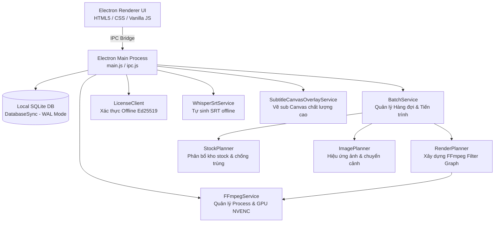

# BÁO CÁO PHÂN TÍCH TOÀN BỘ CODEBASE: VideoBatchStudio-Desktop-Offline (v1.7.0)

> **Thời gian cập nhật:** 2026-09-03  
> **Phiên bản:** 1.7.0 Offline Standalone  
> **Mục tiêu:** Hệ thống Desktop render video hàng loạt và đơn lẻ offline hoàn toàn trên Windows, hỗ trợ GPU NVENC tự động, xử lý phụ đề canvas, kho stock thông minh, hiệu ứng layer và bản quyền ngoại tuyến Ed25519.

---

## 1. Tổng quan Kiến trúc Hệ thống

Hệ thống được xây dựng theo mô hình **Electron Desktop Offline** kết hợp backend **Node.js (>=22)** với `node:sqlite` tích hợp sẵn và công cụ xử lý đồ họa/video **FFmpeg/FFprobe/Whisper**.

---

## 2. Chi tiết các Phân hệ & Module Chính

### 2.1. Khởi tạo & Vòng đời Ứng dụng (Main & IPC)
- [`src/main/main.js`](file:///E:/a/VideoBatchStudio-Desktop-Offline/src/main/main.js):
  - Khởi tạo cửa sổ chính Electron (1660x1000).
  - Tải cơ sở dữ liệu SQLite cục bộ, khởi động các service nền: `FFmpegService`, `BatchService`, `ProjectService`, `TemplateService`, `MediaLibraryService`, `LicenseClient`, `WhisperSrtService`, `SubtitleCanvasOverlayService`.
  - Kiểm tra hệ thống GPU trong background và chạy quy trình phục hồi (`RecoveryService`) nếu phiên làm việc trước bị tắt đột ngột.
  - Đóng tiến trình an toàn khi thoát (`before-quit`), dọn dẹp các sub-process FFmpeg.
- [`src/main/ipc.js`](file:///E:/a/VideoBatchStudio-Desktop-Offline/src/main/ipc.js):
  - Đăng ký toàn bộ các kênh giao tiếp IPC: chọn file/folder, kiểm tra phần cứng GPU, render preview, quản trị project, template, kho media, quản lý batch render, kích hoạt bản quyền offline.

### 2.2. Cơ sở Dữ liệu Cục bộ (Database Layer)
- [`src/main/database.js`](file:///E:/a/VideoBatchStudio-Desktop-Offline/src/main/database.js):
  - Sử dụng module chuẩn `node:sqlite` (`DatabaseSync`), tối ưu `PRAGMA journal_mode = WAL;` và `PRAGMA busy_timeout = 5000;`.
  - Quản lý các bảng: `projects`, `templates`, `template_layers`, `export_presets`, `transition_presets`, `media_libraries`, `media_assets`, `batches`, `batch_jobs`, `stock_reservations`, `render_plans`, `render_attempts`, `reports`.
  - Hỗ trợ atomic transactions và cơ chế khóa reservation tránh trùng stock giữa các jobs chạy song song.

### 2.3. Lõi Xử lý Render & Video Engine
- [`src/main/services/render-planner.js`](file:///E:/a/VideoBatchStudio-Desktop-Offline/src/main/services/render-planner.js):
  - Trái tim của hệ thống xuất video.
  - Xây dựng câu lệnh FFmpeg phức tạp (`filter_complex`):
    - Background: Ghép nối stock video hoặc chuỗi ảnh với các bộ chuyển cảnh mềm (`fade`, `dissolve`, `hblur`, `zoomin`, `fadegrays`, `smoothleft`...).
    - Video Disclaimer & Job Intro video: Ghép nối đoạn mở đầu trước/sau disclaimer.
    - Layer Composite: Tách phông xanh (`chromakey`), layer ảnh theo voice (`VOICE_IMAGE`), logo, watermark, animation zoom/pan/flip.
    - Subtitle: Xử lý phụ đề Canvas Overlay hoặc CPU libass.
  - Tự động nhận diện lỗi phần cứng (NVENC init error, CUDA OOM, driver crash) để tự chuyển đổi thông minh sang preset tương thích (GTX 10xx P2) hoặc fallback về CPU `libx264`.
- [`src/main/services/stock-planner.js`](file:///E:/a/VideoBatchStudio-Desktop-Offline/src/main/services/stock-planner.js):
  - Thuật toán phân bổ stock thông minh (`createDurationStockAllocator` và `planStockSegments`).
  - Hỗ trợ chế độ quay vòng (multi-pass) với tốc độ điều chỉnh (`playbackRate`), lật hình (`flip`) và zoom nhẹ (`zoom`) ở pass 2 để nhân đôi thời lượng kho stock mà không bị trùng lặp cảm giác thị giác.
- [`src/main/services/ffmpeg.js`](file:///E:/a/VideoBatchStudio-Desktop-Offline/src/main/services/ffmpeg.js):
  - Quản lý process tree của FFmpeg, hỗ trợ ngắt an toàn trên Windows (`taskkill /PID /T /F`).
  - Kiểm tra khả năng phần cứng GPU NVIDIA qua `nvidia-smi` và benchmark thử encoder `h264_nvenc` / `hevc_nvenc`.
  - Giám sát tiến độ render, ước lượng thời gian và ghi nhật ký stdout/stderr chi tiết.

### 2.4. Bản quyền Ngoại tuyến (Offline Licensing)
- [`src/main/services/license-client.js`](file:///E:/a/VideoBatchStudio-Desktop-Offline/src/main/services/license-client.js):
  - Hệ thống bản quyền độc lập hoàn toàn không cần server hay internet.
  - Lấy mã định danh phần cứng qua `MachineGuid` trên Windows Registry kết hợp SHA-256.
  - Xác thực chữ ký số Ed25519 bằng public key đóng gói sẵn trong ứng dụng.
  - Lưu cache bản quyền được mã hóa qua Windows DPAPI (`Electron safeStorage`).
  - Chống lùi đồng hồ hệ thống (`Clock rollback detection`).
- [`admin-tools/generate-license.js`](file:///E:/a/VideoBatchStudio-Desktop-Offline/admin-tools/generate-license.js) & [`admin-tools/generate-keypair.js`](file:///E:/a/VideoBatchStudio-Desktop-Offline/admin-tools/generate-keypair.js): Bộ công cụ cho admin tạo cặp khóa và sinh license key cho người dùng.

### 2.5. Xử lý Phụ đề & Âm thanh Nâng cao
- [`src/main/services/subtitle-canvas-overlay-service.js`](file:///E:/a/VideoBatchStudio-Desktop-Offline/src/main/services/subtitle-canvas-overlay-service.js): Phân tích SRT/ASS, căn chỉnh dòng phụ đề, tính kích thước chữ và vẽ overlay phụ đề trực tiếp.
- [`src/main/services/whisper-srt-service.js`](file:///E:/a/VideoBatchStudio-Desktop-Offline/src/main/services/whisper-srt-service.js): Tích hợp engine Whisper cục bộ để tự động sinh file SRT từ file âm thanh voice (MP3/WAV) theo luồng song song có kiểm soát tài nguyên VRAM/RAM.

### 2.6. Giao diện Người dùng (Renderer GUI)
- [`src/renderer/index.html`](file:///E:/a/VideoBatchStudio-Desktop-Offline/src/renderer/index.html), [`src/renderer/app.js`](file:///E:/a/VideoBatchStudio-Desktop-Offline/src/renderer/app.js), [`src/renderer/styles.css`](file:///E:/a/VideoBatchStudio-Desktop-Offline/src/renderer/styles.css):
  - Giao diện Dark theme chuyên nghiệp, chia tab rõ ràng:
    1. **Render Hàng loạt (Batch)**: Quét thư mục voice + SRT + stock, chọn template, cấu hình disclaimer, render hàng loạt.
    2. **Render 1 Video (Single)**: Quy trình nhanh nhất (1 voice + 1 SRT + 1 stock cắt sẵn), tối ưu tốc độ tối đa.
    3. **Trình soạn thảo Mẫu (Template Visual Editor)**: Kéo thả layer trực quan trên canvas 1920x1080, chỉnh sửa kích thước 4 góc, canh tỉ lệ, đổi màu/viền phụ đề, gắn tài nguyên xanh/ảnh theo voice.
    4. **Kho Tài nguyên (Media Library)**: Quản lý video stock, ảnh nền, logo, âm thanh, video phông xanh.
    5. **Kích hoạt Bản quyền (License)**: Xem Machine Code và nhập License Key.

---

## 3. Các Chế độ Render Hỗ trợ

| Chế độ | Mô tả | Hiệu năng |
| :--- | :--- | :--- |
| **SINGLE_STOCK** *(v1.7)* | 1 Voice + 1 SRT + 1 Video nền đã cắt sẵn dài hơn voice. Không quét kho, không nối clip. | Nhanh nhất (Tận dụng tối đa NVENC) |
| **STOCK_VIDEO** | Nối nhiều clip stock ngẫu nhiên hoặc tuần tự, có chuyển cảnh chéo (`Cross Dissolve` / `Fade`). | Tiêu chuẩn cho video dài |
| **IMAGE_SEQUENCE** | Chuỗi ảnh tĩnh tự đổi sau 5s, có zoom/pan và chuyển cảnh mềm. | Nhẹ, phù hợp nội dung kể chuyện |
| **MANUAL_MEDIA** | Dùng 1 file media nền cố định duy nhất. | Đơn giản, linh hoạt |

---

## 4. Đánh giá Chất lượng Codebase

1. **Tính hoàn thiện (Completeness)**: Rất cao. Codebase đã triển khai đầy đủ từ lõi xử lý, giao diện, lưu trữ, kiểm tra lỗi, khôi phục sau sự cố đến đóng gói Windows NSIS.
2. **Khả năng tự phục hồi (Resilience)**: FFmpeg process crash, NVENC driver failure, stock shortage, template mismatch đều có cơ chế bắt lỗi và fallback rõ ràng.
3. **Hiệu năng (Performance)**: Sử dụng worker pool, quản lý luồng CPU theo số lõi, tự động chọn encoder NVENC phù hợp từng dòng card đồ họa (từ GTX 1050/1060 đến RTX 40xx).

---

## 5. Nhật ký Biên dịch & Đóng gói (Build Log)

* **Ngày thực hiện:** 2026-09-03
* **Cú pháp mã nguồn (`npm run check`):** PASS (77 files JS kiểm tra thành công).
* **Kiểm thử tự động (`npm test`):** PASS 165/165 tests (100% pass, 0 fail).
* **Đóng gói Windows (`npm run dist:win`):** Thành công.
  * Bộ cài NSIS: `release/Video-Batch-Studio-1.7.0-x64.exe` (~166 MB)
  * Thư mục thực thi giải nén: `release/win-unpacked/Video Batch Studio.exe`

